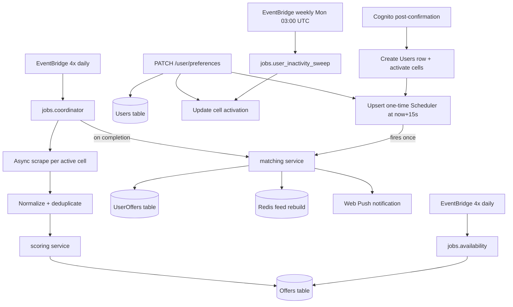

# Data Pipeline

End-to-end flow from scraping to user feed.

## Pipeline stages



Matching is **event-driven** — there is no constant poll. Two independent triggers run the user matching logic (see [Trigger sources](#trigger-sources)).

## Market cells

### Definition

A global market cell is identified by:

```
(country, month, min_stars, board, adults, children)
```

- `country` — ISO 3166-1 alpha-2
- `month` — `YYYY-MM` (derived from user date range)
  - **Travel Month Expansion**: If a user's date range spans multiple months, they activate cells for all months overlapping that range. If the user's travel dates are not configured ("Any"), they activate cells for the current month and the next 5 months (6 months total).
- `min_stars`, `board`, `adults`, `children` — from user preferences

This same tuple is used for **scraping**, **statistical comparison**, and **scoring**.

### Activation and Decoupling Model

Cells are global — not per-user. When any user's preferences require a cell, `activation_count` increments. Scraping runs once per active cell regardless of how many users share it.

To keep cell scraping decoupled from user-specific details (and avoid expensive queries to find active users during scraping):

1. **Departure Airports**: Scraper requests are always sent with "Any" departure airport. User-specific departure airport preferences are applied as filters on the backend during the user matching phase.
2. **Duration / Stay Length**: Scraper requests query a wide default range of `2-28` nights. Exact min/max duration filters are applied during the user matching phase.
3. **Representative Child Age**: Providers require birth dates to calculate prices. Because global cells only track the _number_ of children, cells with `children > 0` are scraped using a representative child age of **8 years old** (birth date calculated as January 1st of `current_year - 8`). Exact matching filters on child ages are applied in Python during matching.

### Coordinator (`jobs.coordinator`)

Triggered 4× daily by EventBridge (`cron(0 6,10,14,18 * * ? *)`, UTC). A continuation invoke uses the same payload type with `remaining_cells` set (see [Error handling](#error-handling)).

1. Scan the `MarketCells` table (all rows are active by definition — a cell exists only when `activation_count > 0`). On continuation, load only the ids in `remaining_cells`.
2. Skip a cell whose month is entirely in the past. `month_date_bounds(cell.month)` is the first and last calendar day of `YYYY-MM`; both must be before today. Skipped cells are not scraped, do not update `last_scraped_at`, and do not soft-delete offers by absence. They stay in `MarketCells` until activation drops to 0.
3. Schedule one async scrape task per remaining cell with bounded concurrency (an `asyncio` worker pool of up to 10 workers).
4. Each task calls wakacje.pl and tui.pl APIs (see [providers/](../providers/index.md)). Each provider search retries up to 3 times with exponential backoff. A provider failure is logged and the other provider's results are still ingested.
5. Pass raw results to normalization → scoring → `Offers` table. If every scored offer fails validation, skip persistence for that cell so existing offers are not marked unavailable by an empty result set.
6. After the pool finishes, bulk-match users whose preferences overlap the cells scraped in **this** invocation.

The worker pool fan-out lives in the orchestrator; per-cell work calls `async` `core` functions, and CPU-bound scoring is offloaded via `asyncio.to_thread`. See [system-overview.md](system-overview.md#concurrency-model-for-jobs).

## Scrape → normalize

1. Map provider fields to canonical offer schema.
2. Compute semantic fingerprint → `offer_id`.
3. **Collapsing/Deduplication**: Collapse provider search results with the same semantic fingerprint (intra-scrape and cross-provider), keeping the lowest price variant and accumulating sources (see [data-model.md](data-model.md#deduplication-and-variant-collapsing)).
4. **Provider metadata:** persist `metadata.wakacje_pl` or `metadata.tui` (see [data-model.md](data-model.md#offer-metadata)) — required for later per-offer availability checks without re-scraping the offer page.
5. Attach `cell_id` from the scrape context.
6. Forward to scoring.

## Scoring (scoring service)

See [attractiveness.md](attractiveness.md).

Only offers passing stage 2 are written to `Offers`. If an offer already exists in DynamoDB for the same `(cell_id, offer_id)`, the ingestion process retrieves the existing item, merges the new and old variant sources, updates the primary offer details with the lowest-priced variant, and saves it back (preventing overwrite of other provider data).

## User matching (matching service)

### Trigger sources

There is **no 2-minute sweeper**. Two distinct events drive matching:

| Trigger           | Cause               | Mechanism                                                                        |
| ----------------- | ------------------- | -------------------------------------------------------------------------------- |
| Per-user re-match | preferences changed | EventBridge Scheduler one-time schedule `at(now + 15s)`, debounced by overwrite  |
| Bulk re-match     | new offers scraped  | `jobs.coordinator`, on completion, matches users of the affected (updated) cells |

### Preference debouncing (EventBridge Scheduler)

On `PATCH /v2/user/preferences`:

1. Save latest preferences to `Users`.
2. Update market cell activation (increment/decrement).
3. **Upsert** a one-time schedule named `match-{user_id}` with `ScheduleExpression = at(now + 15s)` and `ActionAfterCompletion: DELETE`.

**Coalescing:** the schedule name is deterministic (`match-{user_id}`), so each edit simply overwrites the fire time — repeated edits collapse into **one** match run 15s after the last edit. No polling, no `refresh_after` field, no GSI.

**Target:** the schedule invokes the lambdalith with payload `{ "type": "match_user", "user_id": "..." }` (handled by the dual-entry handler).

**Race handling:** if a PATCH lands while a match is mid-run, the run used near-current preferences and the new PATCH has already scheduled another run in 15s — eventual consistency without an explicit compare-and-swap.

### Match logic

For each claimed user:

1. Load preferences.
2. **Self-healing month shift** (open-ended dates only). See [Cell window reference date](#cell-window-reference-date). This is the only path that releases the previous open-ended window.
3. Resolve required `cell_id` set.
4. Query `Offers` for those cells.
5. Filter in Python using the user's exact preferences:
   - Match departure airports (if list is not empty `[]`).
   - Match exact stay duration bounds (`duration_min` to `duration_max`).
   - Match travel date range (`date_from` to `date_to`).
   - Match minimum TripAdvisor rating (`min_rating`).
   - Match children exact ages/birthdays (re-checking suitability if children are present).
6. **Sync `UserOffers` rows**:
   - Query existing `UserOffers` keys for the user.
   - Diff the new matches against the old matches.
   - Batch-delete obsolete matches and batch-write new matches (limits DynamoDB write churn).
7. Rebuild Redis feed (increment `feed_version`, invalidating cached ZSETs).
8. If the feed changed, increment `feed_version`. If the match **inserted** new rows and push is enabled, send one randomly chosen Polish template (`Nowe oferty!`, `Nowe wycieczki!`, or `Nowe okazje!`). The payload is title and body only. If the push endpoint returns HTTP 403, 404, or 410, disable push on the user record.

## Availability check (`jobs.availability`)

Triggered 4× daily.

Baseline is **availability-by-absence**, which works for both providers without a per-offer endpoint: an offer no longer returned by the latest scrape of its cell is marked `available = false` and given a 14-day DynamoDB TTL; DynamoDB eventually removes the row.

Optional refinement for fresher availability _between_ scrapes (requires provider metadata persisted at ingest — see [data-model.md](data-model.md#offer-metadata)):

- **tui.pl:** `GET /api/www/hotel-cards/offers?offerCode={metadata.tui.offer_code}` (returns `OK` / `UNAVAILABLE`).
- **wakacje.pl:** two-step JSON API using stored `metadata.wakacje_pl` + canonical offer fields (no offer-page HTML fetch):
  1. `POST /v2/api/getCalculatorOfferVariants/{external_offer_id}` — empty `offers` ⇒ unavailable for this configuration.
  2. `GET /v2/api/checkOfferAvailability` — `data.availability` + `data.status === "OK"`.

Contract details: [providers/wakacjepl/contract.md](../providers/wakacjepl/contract.md#offer-availability). Prototype: `notebooks/wakacje_pl_availability.ipynb`.

If the check determines that the offer is no longer available, the offer is **soft-deleted**: `available = false` and `ttl` set to now + 14 days (DynamoDB TTL). The job then triggers a bulk user re-matching run (`MatchingService.bulk_match_users`) on the affected cells so non-favorited matches leave the feed immediately; favorited `UserOffers` rows are retained until the Offer TTL expires. Otherwise, if the offer is still available but its price has changed, `price_total` is replaced and `price_per_person` / `price_per_day` are recomputed as `price_total / (adults + children)` and `price_total / duration / (adults + children)` (quantized to 0.01 PLN).

The job only checks offers that are still `available` and whose `cell_id` is in the current `MarketCells` scan. A provider error on one offer is logged and that offer is left unchanged.

## User activity and inactivity

There is no per-offer seen flag. Activity is a session boundary plus a weekly cell release.

### Session touch

Every authenticated request (`get_current_user`) schedules `UserActivityService.touch` with `asyncio.create_task`. The handler does not await it, so a request that finishes before the Redis write can miss the session update.

Redis key `user:{user_id}:session` is `SET` with `EX` (TTL = `SESSION_GAP_MINUTES` × 60, default 30 minutes) and `GET`.

- A previous value means the user is still inside the same session. Nothing is written to DynamoDB.
- A missing key means a new session. `Users.new_since` is set to the previous `last_active_at`, and `last_active_at` advances to now.

`GET /v2/offers?new=true` uses `new_since` as the cutoff and keeps offers with `UserOffers.matched_at >= new_since`.

### Weekly sweep (`jobs.user_inactivity_sweep`)

EventBridge `cron(0 3 ? * MON *)` (Monday 03:00 UTC) sends `{ "type": "sweep_inactive_users" }`.

1. Cutoff is now minus `INACTIVITY_THRESHOLD_DAYS` (default 7).
2. Scan `Users` where `last_active_at < cutoff` and `is_active = true`.
3. Decrement `activation_count` for every cell in today's window (see [Cell window reference date](#cell-window-reference-date)), not the window stored on `updated_at`. One DynamoDB `ADD -1` is issued per user per cell, concurrently. A count at or below 0 deletes the row. A missing row raises `ItemNotFoundException`. Updates that already succeeded are not rolled back, and `is_active` is cleared only after the whole decrement returns. The next Monday selects the same users and decrements again.
4. Set `is_active = false` only when it is currently `true`. A later run does not decrement users already marked inactive.

The sweep ignores the Lambda `context` and does not continue itself.

The sweep does not delete the user, preferences, `UserOffers`, or offers. `bulk_match_users` still scans every user, including inactive ones. Overlap uses today's window, so a past-month cell that is still counted does not select that user. A scraped cell in today's window does, and matching runs without setting `is_active` back to true.

### Coming back

`GET` or `PATCH /v2/user/preferences` loads the user through `get_or_create_user`. If `is_active` is false, `ensure_active` sets it true and then increments today's cell window. It does not decrement the window from when the user went idle. `get_or_create_user` schedules `match-{user_id}` only after that increment returns. If the increment raises, the user stays marked active and a later preferences read does not retry it. Other authenticated routes only refresh the session key; they do not restore cells.

## Cell window reference date

`generate_required_cells` builds `YYYY-MM` buckets from a reference date. Callers that omit it use `date.today()`.

- Both `date_from` and `date_to` are unset: the reference month plus the next five months (six buckets).
- Otherwise the start month is `max(date_from, reference)` (a missing `date_from` uses the reference). Months before the reference are not included. The end month is `date_to` when set, otherwise five months after the start. The day inside `date_from` / `date_to` does not split a month.
- Country codes are not de-duplicated. A repeated code activates and releases that cell once per copy.

| Caller | Reference date | Cells it changes |
| --- | --- | --- |
| `PATCH /v2/user/preferences` | Today for **both** the saved preferences and the incoming ones | Only dimensions that differ (country, board, stars, adults, child count). A month that has aged out is in neither set, so its count stays. |
| New user (`get_or_create_user`) | Today | Activates the current window. |
| `match_user_offers` self-heal | Old window: `user.updated_at` date. New window: the match reference (today unless the caller passes one) | Runs only when **both** travel dates are unset and `updated_at` is in a different calendar month. Writes `updated_at` as that reference date at the current UTC time of day, then shifts cells. |
| `bulk_match_users` overlap test | Argument from the caller. The coordinator passes none, so today | A user is matched only when today's window overlaps a cell this run actually scraped. |
| Inactivity sweep | Today | Decrements today's window. |
| `ensure_active` | Today | Increments today's window. Does not decrement. |
| `DELETE /v2/auth/account` | `user.updated_at.date()` | Decrements that window, which can differ from the cells still holding a count. |

`updated_at` is the month self-heal compares. These writes move it:

- Creating the user.
- `PATCH /v2/user/preferences` (set to now **before** the cell diff).
- `POST /v2/user/push/enable` and `POST /v2/user/push/disable`.
- Self-heal itself.

Session touch updates `last_active_at` and `new_since` only.

A preference save or a push toggle in a new month makes `updated_at` current, so the match 15 seconds later skips self-heal. The preference diff used today on both sides, so the previous open-ended months stay incremented. Past months are still loaded by the coordinator and then skipped (`is_cell_month_past`). A fixed date range never enters self-heal, so months that fall before today leak the same way.

Example: open dates activated in June 2026 cover `2026-06` through `2026-11`. A preference PATCH on 2 July diffs July–December against itself, sets `updated_at` to July, and leaves the June cell in place. After 30 June that cell is not scraped.

If self-heal's `put` succeeds and the following activation raises, `updated_at` is already this month. The next match will not try the shift again. Successful `ADD`s from that attempt are not rolled back.

## Redis feed rebuild and lazy ZSET pagination

### Lazy ZSET Building

The ZSET is built lazily on the first `GET /v2/offers` request for a specific sort field, order, and filter:

1. Retrieve the user's current `feed_version` from the key `user:{user_id}:feed_version`.
2. Check if ZSET key `user:{user_id}:sort:{field}:{order}:filter:{filter_mode}:v{version}` exists in Redis. `filter_mode` is `all`, `country:{ISO}`, or `new:{unix_seconds}`.
3. If not cached:
   - Query all `UserOffers` for the `user_id` from DynamoDB.
   - Batch-get corresponding offers from the `Offers` table using their `(cell_id, offer_id)` keys. Hydration misses prune those `UserOffers` rows and bump `feed_version`.
   - Drop `available = false` offers, then apply `filter_mode` (country via the cell ISO code, or `new` via `matched_at`).
   - Write members `offer_id:cell_id` with computed scores (see [data-model.md](data-model.md#lazy-sort-views-zset)). Redis orders the ZSET. TTL: 24 hours.
4. Paginate using the ZSET:
   - If `order == desc`, execute `ZREVRANGEBYSCORE` or `ZRANGE ... REV`.
   - If `order == asc`, execute `ZRANGEBYSCORE` or `ZRANGE`.

### Cursor-Based Pagination

- **Cursor Structure**: The cursor is a base64-encoded JSON string:
  ```json
  {
    "offset": 20,
    "feed_version": 42
  }
  ```
- **Query Resolution**:
  - The API decodes the cursor and reads the limit (default `20`).
  - If the cursor's `feed_version` matches the current `feed_version` in Redis, fetch ZSET elements from index `offset` to `offset + limit - 1`.
  - If the `feed_version` does not match, the feed has changed. The API resets the request to page 1 (`offset = 0`), rebuilds the ZSET, and returns the new `feed_version` in the response, allowing the client to reset pagination and reload the feed.

## Error handling

| Failure                        | Behavior                                                                                               |
| ------------------------------ | ------------------------------------------------------------------------------------------------------ |
| Provider timeout               | Retry up to 3× per cell per run; log and continue                                                      |
| Scoring error for one offer    | Skip offer; log                                                                                        |
| Match job failure for one user | EventBridge Scheduler retry policy (max attempts → DLQ); next PATCH or post-scrape run also re-matches |
| Lambda timeout approaching     | With under 15s left, workers stop. If `LAMBDA_FUNCTION_ARN` is set, the cron Lambda async-invokes itself with `{ "type": "scrape_offers", "remaining_cells": ["..."] }`. This invocation still bulk-matches cells it finished. Without the ARN, leftover cells wait for the next cron. |

## Future escape hatch

If active cell count exceeds the cron Lambda's single-invocation capacity:

- Fan out from the cron Lambda to per-cell worker Lambda functions.
- Replace the in-process `asyncio` fan-out with Lambda async invoke per cell.

Domain logic in `core/` remains unchanged.
